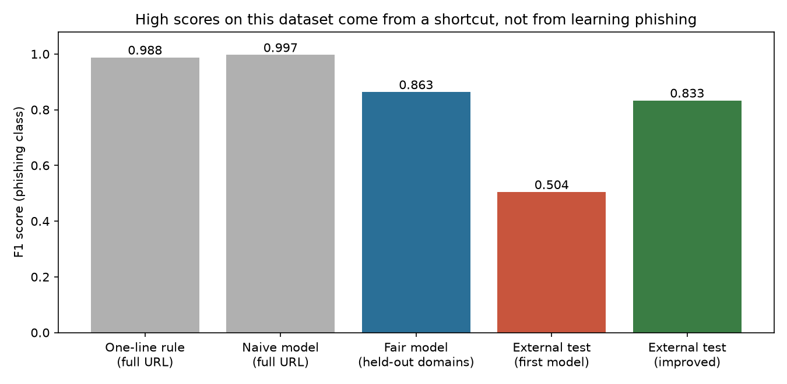
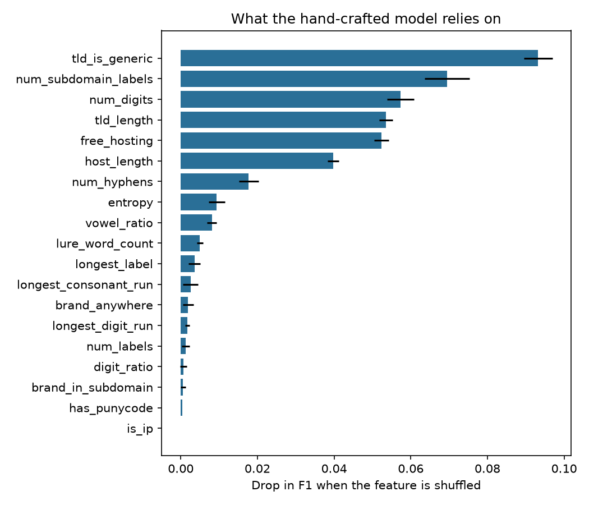
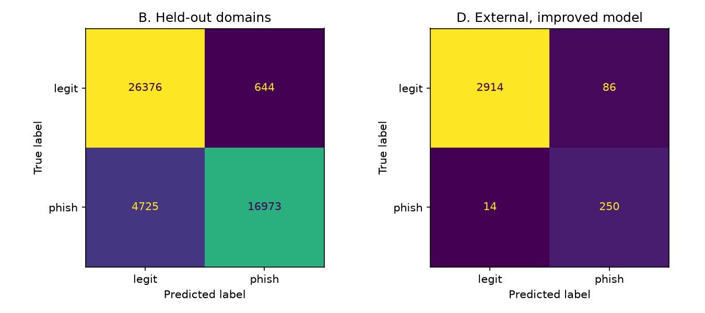

# Phishing URL Detector: what a 99.7% score was hiding

A machine learning model that flags phishing links from the text of the URL alone, without opening the page.

I work in cyber threat intelligence, where a big part of the job is chasing fake banking and wallet sites that copy real brands. I wanted to see how far a lightweight, URL-only model could go, and to test it the way it would actually be used: on links it has never seen before.

The most useful thing I found was not the model. It was that the standard way of testing on this dataset gives a score that means almost nothing.



## Summary

| Experiment | What it tests | F1 (phishing) | False-positive rate |
|---|---|---|---|
| A. One-line rule | `if URL starts with "https://www." → legitimate` | 0.988 | 0.0% |
| A. Naive model | Character model on the full URL, random split | 0.997 | 0.0% |
| B. Fair model | Hostname only, duplicates removed, split by domain | 0.863 | 2.4% |
| C. External test | Model B on today's live phishing + popular real sites | 0.504 | 16.0% |
| D. Improved model | Broader legitimate training data, same external test | **0.833** | **2.9%** |

## 1. The shortcut

The [PhiUSIIL dataset](https://archive.ics.uci.edu/dataset/967/phiusiil+phishing+url+dataset) (235,795 URLs) is widely used for phishing detection, and papers often report accuracy above 99%.

When I explored the data, I found that **every single legitimate URL (134,850 of them) has the form `https://www.example.com` with no path.** Only 2.4% of phishing URLs start that way. So a one-line rule gets an F1 of 0.988, and a character-level model on the full URL reaches 0.997. Neither has learned anything about phishing. They have learned how the dataset was collected.

## 2. A fair test

To remove the shortcut I:

1. **Reduced every URL to its hostname**, dropping the scheme, `www.`, port and path. `https://www.paypal.com` and `paypal.com` now look the same.
2. **Removed duplicates** and any hostname that appeared with both labels, which left 219,036 unique hosts (84,244 phishing).
3. **Split by registered domain**, not by row, so no domain is in both training and test. Otherwise the model can memorise `evil-site.com` from training and "recognise" `login.evil-site.com` in the test set.

I trained two models and averaged their probabilities:

- **Gradient boosting on 19 hand-crafted features**: subdomain count, digits, hyphens, entropy, whether the TLD is generic, free-hosting platforms such as `web.app` or `godaddysites.com`, brand names and lure words like "verify" or "wallet". See [`src/urlfeatures.py`](src/urlfeatures.py).
- **Logistic regression on character 2–5-grams** of the hostname, which picks up patterns that are hard to write by hand.

| Model (held-out domains) | Precision | Recall | F1 | ROC-AUC |
|---|---|---|---|---|
| Hand-crafted features + gradient boosting | 0.940 | 0.730 | 0.822 | 0.893 |
| Character n-grams + logistic regression | 0.927 | 0.803 | 0.861 | 0.934 |
| Average of both | 0.963 | 0.782 | 0.863 | 0.933 |

An F1 of 0.86 is lower than 0.997, but it is an honest number.



The features that matter most match what analysts look for by hand: unusual TLDs, deep subdomains, digits in the hostname, and pages on free hosting platforms.

## 3. Testing on data from somewhere else

A held-out split still comes from the same collection. So I built a second test set from independent sources:

- **264 phishing hosts** from the [OpenPhish](https://openphish.com/) community feed, downloaded on 16 Nov 2026, about two years after PhiUSIIL was collected.
- **3,000 legitimate domains**, sampled at random from ranks 10,001–500,000 of the [Tranco](https://tranco-list.eu/) top-sites list.

Hosts already in the training data were removed.

The model still caught 95% of the live phishing, but it also flagged **16% of real websites**. In practice that would make it useless, because analysts would stop trusting it.

The cause was the training data again. PhiUSIIL's legitimate sites are a narrow sample, so the model had not seen enough ordinary domains, such as country TLDs or long brand names, to know they are normal.

## 4. The fix

I added about 40,000 extra legitimate domains to the training set, taken from Tranco ranks 500,001–1,000,000. That range does not overlap the external test sample.

| External test | Precision | Recall | F1 | False-positive rate |
|---|---|---|---|---|
| Before | 0.343 | 0.951 | 0.504 | 16.0% |
| After | 0.744 | 0.947 | **0.833** | **2.9%** |

Recall stayed the same, and false positives fell by more than five times.

I also tried choosing the decision threshold on the held-out set, aiming for at most 2% false positives there. That threshold (0.40) did worse on the external data, with 6.6% false positives. Tuning on in-distribution data did not carry over, so the shipped model uses 0.5.



## Try it

```bash
python -m venv .venv
.venv\Scripts\activate            # Windows  (macOS/Linux: source .venv/bin/activate)
pip install -r requirements.txt
python src/download_data.py       # about 30 MB of downloads
python src/train.py               # about 5 minutes on a laptop
python src/predict.py "http://secure-login-gtbank-verify.web.app/" "https://www.wikipedia.org"
```

```
 0.999  PHISHING  secure-login-gtbank-verify.web.app
 0.077  looks ok  wikipedia.org
```

`predict.py` never visits the URL. It only reads the text.

## Limitations

- **Known false positives.** Very short, well-known domains can score close to 0.5. `github.com` scores 0.51. A real deployment would pair the model with an allow-list of top domains.
- **The fix and the external test both use Tranco.** The two ranges don't overlap, but they share a source. So part of the improvement may come from matching Tranco's style, not from general learning. A test on legitimate URLs from a third source, such as real email or proxy logs, would settle this.
- **The external phishing set is small** (264 hosts from one day).
- **Hostname only.** The path and query string are ignored on purpose, to avoid the shortcut. Real phishing kits often leave clues there, such as `/wp-content/`, `/login.php` or long tokens.
- **Free-hosting phishing is hard to see.** A host like `something.web.app` gets most of its signal from the platform name. If attackers move to a platform the model hasn't seen, recall will drop.

## What I would do next

- Add path and query features, using a dataset whose legitimate URLs also have paths, and run the same shortcut check on it.
- Build a time-based evaluation: train on older phishing feeds and test on newer ones, to measure how fast the model goes out of date.
- Add features from certificate transparency logs and domain registration age, which are strong signals in real threat intelligence work.
- Focus on brand impersonation of African banks and fintechs, which global datasets barely cover.

## Project layout

```
src/urlfeatures.py    hostname normalisation and the 19 hand-crafted features
src/train.py          experiments A–D, metrics, figures, saves the model
src/predict.py        command-line scoring
src/download_data.py  fetches the three public data sources
reports/results.json  every number in this README
reports/figures/      charts
```

## Data and credits

- Prasad, A. & Chandra, S. (2024). *PhiUSIIL: A diverse security profile empowered phishing URL detection framework based on similarity index and incremental learning.* Computers & Security, 136. Dataset: UCI Machine Learning Repository, CC BY 4.0.
- OpenPhish community feed, https://openphish.com/
- Le Pochat, V. et al. (2019). *Tranco: A Research-Oriented Top Sites Ranking Hardened Against Manipulation.* NDSS. https://tranco-list.eu/

Built with Python, scikit-learn, pandas and matplotlib.

Author: Abdulazeez Abdulhakeem Abiola, [LinkedIn](http://www.linkedin.com/in/ithelance) · [Medium](https://ithelance.medium.com/)
